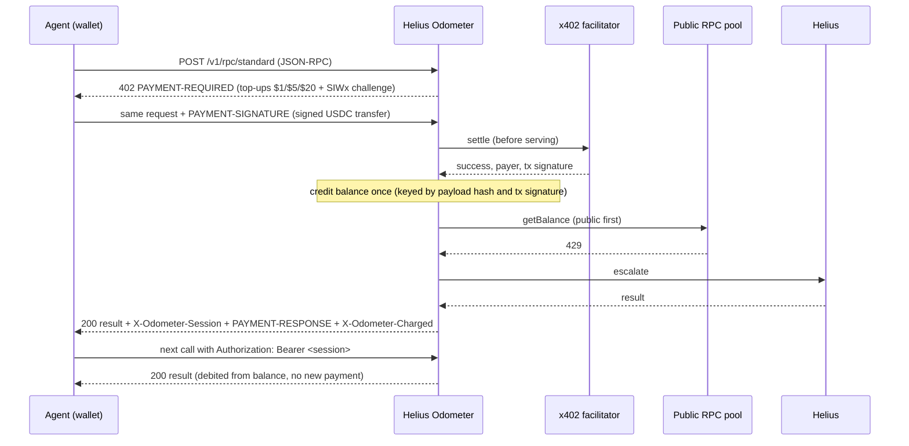

# Helius Odometer

**Pay-per-call Solana RPC for AI agents over [x402](https://x402.org). Wallet in, answers out: no signup, no email, no API key.**

An agent pays in USDC from its own wallet, picks a speed tier, and gets routed accordingly: cheap reads from free public RPC, everything that needs it through Helius (DAS, `getProgramAccounts`, staked `sendTransaction`). It pays once on-chain for a prepaid top-up, then every call is debited from that balance in a single HTTP round trip.

> **Status:** working prototype, not deployed, not taking deposits. The fixes from the [2026-11-09 code review](docs/reviews/2026-11-09-code-review.md) are in ([response](docs/reviews/2026-11-09-response.md)). Commercial launch is gated on written permission from Helius (see [the permission gate](docs/PLAN.md#the-permission-gate-unresolved-and-it-gates-launch)) and an approved live pilot. This is an independent project, not affiliated with or endorsed by Helius.

## What works today

- **x402 v2 payments on Solana** with the official `@x402/*` SDKs: 402 challenges, USDC `exact` top-ups settled before the call is served, replay-proof crediting.
- **Three tiers.** `economy` uses free public RPC only. `standard` uses public RPC and falls back to Helius automatically. `fast` always uses Helius. Helius-only methods (DAS, indexes) cost the same on every tier.
- **Prepaid balance ledger** on SQLite: reserve, then debit only what was served, so gateway and upstream delivery failures are never charged. The debit and its replay receipt commit together, restarts release interrupted requests uncharged, and one process owns the ledger. Refunds, daily caps, and a reconciliation job that proves balances equal their journal.
- **Operator safety:** ambiguous settlements are frozen for review and credited once against the original receipt with on-chain evidence; alerts go to a webhook; `GET /admin/readiness` checks the launch gates, including custody on-chain against what agents are owed.
- **Agent identity without accounts.** Sign-In-With-X (SIWS) proofs are bound to the gateway origin with single-use nonces. Short-lived session tokens remove the per-call 402 round trip.
- **Routing safeguards** from mature routers: health polling, slot-lag ejection, 429 cooling, per-upstream rate limits, commitment normalization, per-wallet `minContextSlot` floors, a finalized-data cache, sticky transaction follow-ups, and single-attempt `sendTransaction`.
- **Every integration path an agent might use:** plain HTTP with any x402 client, a TypeScript client with a `@solana/kit` transport, a local MCP server (stdio), and a remote MCP endpoint paid over the x402 MCP transport.
- **Verified end to end** on a real `solana-test-validator` with real SPL token transfers, locally and in GitHub Actions.

## How it works



Settling on-chain for every call would cost far more than the call itself. A Solana x402 `exact` settlement costs roughly $0.0012 or more in fees, while one Helius credit costs about $0.000005. So the gateway sells prepaid top-ups and meters calls off-chain. See [docs/PLAN.md](docs/PLAN.md) for the full reasoning.

## Quick start (local, no real funds)

Requires Node 22.13+ and `solana-test-validator` on your PATH ([install Agave](https://docs.anza.xyz/cli/install)). Docker works as a fallback.

```bash
npm install
```

```bash
npm run localnet -- --demo
```

This starts a validator, a test USDC mint, a funded agent wallet, a local x402 facilitator, a Helius stand-in and the gateway. The demo agent then pays one top-up on-chain and makes calls across all tiers:

```
| tier | method | charged (USD) | balance (USD) | upstream | paid top-up |
|---|---|---:|---:|---|---|
| economy | getSlot | 0.00001 | 0.99999 | public | 35q1b9U4VMi7... |
| economy | getBalance | 0.00001 | 0.99998 | public |  |
| standard | getLatestBlockhash | 0.00003 | 0.99995 | public |  |
| fast | getBalance | 0.00005 | 0.9999 | helius |  |
| economy | getAsset | 0.0002 | 0.9997 | helius |  |
one on-chain payment, 5 calls served from the prepaid balance
```

Run `npm run localnet` without `--demo` to keep everything running. It prints `curl` and MCP setup commands.

## Using it from an agent

### Any x402 client

```bash
curl -i -X POST https://odometer.example.com/v1/rpc/economy \
  -H 'content-type: application/json' \
  -d '{"jsonrpc":"2.0","id":1,"method":"getSlot"}'
```

The 402 carries a `PAYMENT-REQUIRED` header listing prepaid top-ups and a `sign-in-with-x` challenge. Stock clients such as `wrapFetchWithPayment` from `@x402/fetch` with `createSIWxClientExtension` work unmodified. They pay once, then sign in on later calls to spend the balance.

### TypeScript client

```ts
import { OdometerClient } from "helius-odometer/client";

const odometer = new OdometerClient({
  baseUrl: "https://odometer.example.com",
  signer, // a @solana/kit KeyPairSigner; the key never leaves your process
  tier: "standard",
  maxTopupUsd: 5, // refuse any single top-up above $5
  maxSpendUsd: 20, // refuse top-ups beyond $20 per client
});

const { result, meta } = await odometer.rpc("getBalance", [address]);
// meta.chargedMicros, meta.balanceMicros, meta.upstreamClass, meta.topup ...

// Or keep using @solana/kit as usual:
const rpc = createSolanaRpcFromTransport(odometer.transport("economy"));
```

The client signs in once with SIWx and reuses the session token. It pays a top-up only when the balance runs out, within your limits, and it pays only in known USDC mints unless you allow another asset explicitly. Top-ups run one at a time, and each is counted against `maxSpendUsd` before it is signed and stays counted even if its response is lost. The count lives in the client instance: pass `initialSpentMicros` and `onSpendChange` to keep it across restarts.

### MCP

**Local (stdio)**: the wallet key stays on the agent's machine.

```bash
claude mcp add helius-odometer \
  -e ODOMETER_URL=https://odometer.example.com \
  -e ODOMETER_WALLET_KEY=/path/to/agent-keypair.json \
  -e ODOMETER_MAX_TOPUP_USD=5 \
  -e ODOMETER_MAX_SPEND_USD=20 \
  -e ODOMETER_SPEND_FILE=/path/to/odometer-spend.json \
  -- npx tsx /path/to/helius-odometer/src/mcp/main.ts
```

`ODOMETER_SPEND_FILE` keeps the `ODOMETER_MAX_SPEND_USD` budget across restarts of the bridge.

**Remote**: `https://odometer.example.com/mcp` speaks streamable-HTTP MCP and is paid over the x402 MCP transport. The first paid tool call asks for a top-up. After that, the session may spend what it paid, from the same IP, until it expires; revoking the wallet ends it at once. A client that sends `Authorization: Bearer <session token>` spends the wallet's full balance instead.

Both expose one tool per tier (`solana_rpc_economy`, `solana_rpc_standard`, `solana_rpc_fast`). Each tool description tells the agent to ask its user how important speed is before it picks one. `odometer_balance`, `odometer_pricing` and `odometer_topup` round out the set.

## Tiers and routing

| | economy | standard | fast |
|---|---|---|---|
| Standard reads (class A) | public pool only, never escalated | public first, Helius on 429, timeout, lag or error | Helius |
| DAS, `getProgramAccounts`, indexes (class B) | Helius | Helius | Helius |
| `simulateTransaction` (class C) | Helius | Helius | Helius |
| `sendTransaction` (class C) | refused | refused | Helius staked path or Sender, single attempt |
| Default price, standard read | $0.00001 | $0.00003 | $0.00005 |

A tier is only offered when it can behave differently. With no public upstreams configured, only `fast` is enabled. With no Helius key, only `economy` is enabled.

## Pricing and billing

Starting prices, all overridable with `PRICING_FILE`:

| Product | Price per call |
|---|---|
| Standard read, economy / standard / fast | $0.00001 / $0.00003 / $0.00005 |
| Heavy reads (`getBlock` ×5, `getTransaction` ×2, ...) | tier price × weight |
| Helius-backed, 1 credit (e.g. `getProgramAccountsV2`, priority fees) | $0.00005 |
| Helius-backed, 10 credits (DAS, `getProgramAccounts`) | $0.0002 |
| `sendTransaction` (fast only) | $0.001 |
| Enhanced Transactions REST | $0.002 |

The billing contract:

- **Not charged:** gateway and upstream delivery failures, including timeouts, rate limits, unhealthy or lagging nodes, exhausted pools and gateway errors.
- **Charged:** valid RPC answers, including errors caused by the request itself, such as invalid params (`-32602`), a failed preflight simulation (`-32002`) or a bad signature (`-32003`). `GET /pricing` lists every billed code.
- **`sendTransaction`:** a charge means the RPC accepted the transaction, not that it landed or succeeded.
- **Separate costs:** your transactions pay their own Solana fees, priority fees and tips. Top-up settlement fees are the facilitator's and operator's cost, so a top-up credits exactly what you paid.

Every response carries `X-Odometer-Charged` and `X-Odometer-Balance` in micros (one micro is 1e-6 USD, one atomic unit of USDC). `X-Odometer-Max-Price` refuses anything pricier than the caller expects. `GET /pricing` lists every method.

## Configuration

All configuration is environment variables; [.env.example](.env.example) documents each one. The essentials:

| Variable | Purpose |
|---|---|
| `PUBLIC_ORIGIN` | Browser-visible origin. SIWx proofs are bound to it. |
| `X402_FACILITATOR_URL` | x402 v2 facilitator with Solana support, or a self-hosted one (`npm run facilitator`). |
| `PAYTO_ADDRESS` | Operator wallet that receives top-ups. Its USDC token account must exist. |
| `SESSION_SECRET` | 32+ random characters for session tokens. |
| `HELIUS_API_KEY` | Enables `fast`, Helius-only methods and escalation. |
| `PUBLIC_UPSTREAMS` | Free public RPC pool for `economy` and `standard`. Review each provider's terms first. |
| `ENABLE_SEND_TRANSACTION` | Off until Helius confirms its staked paths may be fronted. |
| `BAZAAR_DISCOVERY` | Off: Bazaar metadata lets facilitators list the service publicly. |
| `WALLET_DAILY_CAP_USD` | Operator ceiling per wallet per UTC day. Wallets can lower their own cap or stop spending, never lift it. |
| `SERVICE_NAME` | Public name on every surface. Keep it neutral until the Helius name is approved. |
| `ALERT_WEBHOOK_URL` | Where operator alerts go (Slack-compatible or a pager bridge). |

Operations, deployment and the admin API are in [docs/OPERATIONS.md](docs/OPERATIONS.md).

## API

| Endpoint | Purpose |
|---|---|
| `POST /v1/rpc/{tier}` | Paid JSON-RPC (single or batch) |
| `POST /v1/topup` | Pay a top-up without making a call |
| `GET /v1/auth/challenge`, `POST /v1/auth/session` | SIWx sign-in, returns a session token |
| `GET /v1/balance` | Balance, daily caps, totals |
| `GET /v1/receipts?requestId=` or `?idempotencyKey=` | Whether a request was charged, for a client whose response was lost |
| `POST /v1/refunds`, `GET /v1/refunds` | Request a refund of unused balance |
| `POST /v1/account/cap` | Set this wallet's own daily cap: `0` stops spending, `null` removes it. The operator ceiling always applies. |
| `POST /v1/session/revoke` | Revoke every session token for this wallet |
| `POST /v1/bootstrap` | Free, rate-limited RPC for building the payment itself |
| `POST /v1/helius/v0/transactions`, `GET /v1/helius/v0/addresses/{address}/transactions` | Helius Enhanced Transactions behind the same balance |
| `/mcp` | Remote MCP, paid over x402 |
| `GET /pricing`, `/status`, `/health`, `/llms.txt`, `/.well-known/x402` | Free discovery and status |
| `/admin/*` | Operator API, enabled by `ADMIN_TOKEN` |

Request headers: `Authorization: Bearer <session>`, `SIGN-IN-WITH-X`, `PAYMENT-SIGNATURE`, `Idempotency-Key`, `X-Odometer-Max-Price`, `X-Odometer-Send-Via: sender`, `X-Odometer-Rebroadcast: true`.

Diagnostic response headers include `X-Odometer-Upstream-Class`, `X-Odometer-Escalated`, `X-Odometer-Context-Slot`, `X-Odometer-Best-Slot` and `X-Odometer-Latency-Ms`, so agents can verify what they paid for. Details are in [docs/ARCHITECTURE.md](docs/ARCHITECTURE.md).

## Testing

```bash
npm run typecheck
```

```bash
npm test
```

```bash
npm run test:e2e
```

```bash
npm run build && npm run test:audit
```

Unit and integration tests cover the ledger, pricing, routing, consistency, sessions, SIWx and the full HTTP gateway against mock upstreams and a fake facilitator. They include crash and restart cases on a file-backed ledger, backup and restore, ambiguous and late settlements, alert delivery, receipts and readiness. The end-to-end suite runs a real `solana-test-validator` with a real SPL mint and the official x402 facilitator code. It covers on-chain top-ups, balance debits, tier routing, landing a transaction, stock x402 HTTP and MCP clients, MCP agents, replay protection, operator verification of a top-up, and reconciling the ledger and custody against the chain. `test:audit` runs the review's reproduction scripts, which now require the fixed behavior. CI runs all of it and fails, rather than skips, if the validator is missing. More in [docs/TESTING.md](docs/TESTING.md).

## Project layout

```
src/
  server/        app wiring and entrypoint
  payments/      x402 resource server, paywall, SIWx, sessions
  ledger/        SQLite balance ledger
  routing/       upstream pool, router, consistency, cache, rebroadcast
  pricing/       method catalog (classes A-D) and prices
  rpc/           JSON-RPC handler, metered spend path, bootstrap, Helius REST
  api/           public and admin endpoints
  client/        OdometerClient SDK
  mcp/           stdio MCP bridge and remote /mcp endpoint
  facilitator/   self-hostable x402 facilitator (Solana exact)
  bench/         odometer-bench upstream measurement
dev/             local validator and Helius stand-in helpers
scripts/         localnet environment and demo
docs/            plan, architecture, operations, testing, pitch draft
```

## Plan status

| Phase ([plan](docs/PLAN.md#build-phases)) | Status |
|---|---|
| 0: measurement and permission prep | Built: `odometer-bench`, pitch draft, terms checklist. Waiting on: buying a Helius plan, running against real upstreams, sending the pitch (each needs owner approval). |
| 1: paid MVP | Built and tested end to end. |
| 2: routing engine, three tiers | Built and tested. `sendTransaction` stays disabled until Helius confirms Sender may be fronted. |
| 3: scale and settlement | Spend caps, refunds and funnel stats are built. Batch-settlement channels are documented as the next payment option, pending verified facilitator support. Scale-up waits on Helius. |
| Review fixes (2026-11-09) | All P1 and P2 findings fixed and tested ([response](docs/reviews/2026-11-09-response.md)). Not validated: live Helius, mainnet payments and refunds, a live pilot. |

## Guardrails

Purchases, funding wallets with real money, deployments, outreach (including the Helius pitch) and any public listing each need the owner's explicit approval. This repository builds and prepares; it does not do any of those things.
